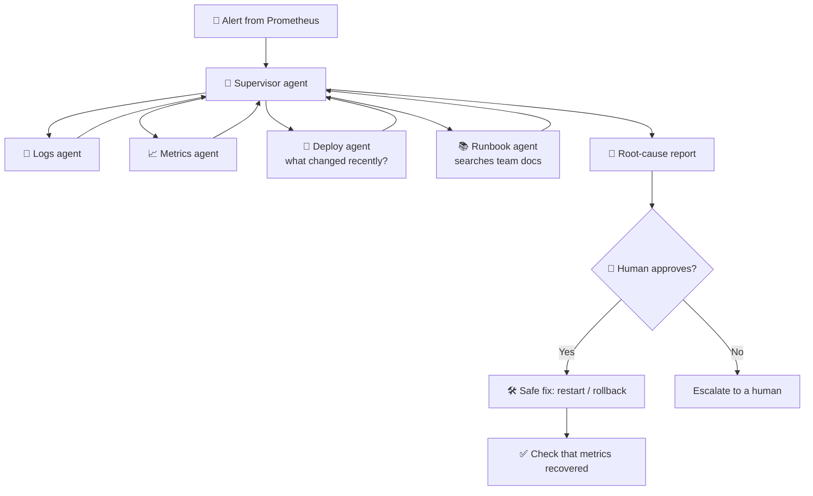

# 🚨 Incident Copilot

**An AI on-call engineer that investigates production incidents, finds the root cause, and fixes things only after a human approves.**

> 🚧 **Being built in public, one day at a time** (Nov 18 – Dec 31, 2026).
> 📖 Follow along: [DAILY_LOG.md](DAILY_LOG.md) · 🎯 Interview prep: [INTERVIEW_QUESTIONS.md](INTERVIEW_QUESTIONS.md)

---

## 🌙 The 3 AM problem

It's 3 AM and your phone buzzes:

```
🔴 ALERT: order-service error rate is above 5%
```

You wake up, open your laptop, and start digging. You read the logs, check the dashboards, ask what was deployed today, and search the runbooks. Forty minutes later you find it: **Redis is timing out and the connection pool is exhausted.**

**Incident Copilot does that digging for you.** By the time you've opened your laptop, it has a report waiting:

```
🔍 Root cause: Redis became unresponsive at 10:42.
   order-service ran out of Redis connections (8/8 used, 31 waiting),
   so every cache read/write failed → HTTP 500s.

📎 Evidence:
   10:42:09  RedisCommandTimeoutException: Command timed out after 2 second(s)
   10:43:10  Redis connection pool exhausted
   ...

🛠️ Suggested fix: restart Redis           [ ✅ Approve ]  [ ❌ Reject ]
```

---

## 🧠 How it works (the target design)

A team of specialist AI agents investigates the incident, like a real on-call team:



**The key idea:** an AI agent is **an LLM + tools + a loop**.

- The **LLM thinks**: *"I should check the logs first."*
- **My code acts**: it runs the tool and reads the logs.
- The result goes back to the LLM, which decides what to check next, until it's confident.

**The AI never touches production by itself.** It can only *ask*, and anything risky needs a human to click Approve.

---

## 🧪 We break it on purpose

To test a copilot you need incidents. So this repo also includes a **small microservice system built to be broken**: Spring Boot services with Kafka, Redis, Postgres and Prometheus.

We inject real failures (Redis going down, slow databases, bad deploys, memory leaks) and check whether the copilot finds the correct root cause. Every injected failure has a known answer, so the copilot gets a **score**, not a vibe check.

---

## 🗺️ Roadmap

| Week | What gets built | Status |
|---|---|---|
| 1 | First tool call → a full agent loop, written from scratch (no frameworks) | ✅ Loop works |
| 1 | The demo microservice system + failure injection | ✅ First version runs |
| 2 | More tools (metrics, deploys), memory, first automated evals | ⬜ |
| 3 | Multi-agent supervisor (LangGraph), human approval, runbook search via **MCP** | ⬜ |
| 4 | Agents as separate services talking over **A2A**, Kafka alert intake, LLM-as-judge | ⬜ |
| 5 | Guardrails (prompt-injection defense, action allow-list), tracing, cost tracking | ⬜ |
| 6 | Evals in CI, live deployment, demo video | ⬜ |

**Done so far:**
- [x] `read_logs` tool: reads a service's logs
- [x] The LLM finds the root cause from the logs (and ignores red herrings)
- [x] **First tool call:** the LLM decides which logs to read; my code runs the tool and sends the result back
- [x] **The agent loop:** keeps investigating until done (max 5 steps). It goes from order-service → Redis on its own and finds the real culprit: a blocking `KEYS` command from an analytics job
- [x] **Three tools** (logs, metrics, recent deploys). The agent picks which to use and finds *what changed*: an `analytics-job` deploy at 10:41:30
- [x] **Never crashes on a bad tool call.** Errors go back to the LLM, which corrects itself
- [x] **The demo system:** order-service + payment-service (Spring Boot) + Redis + Prometheus, started with one `docker compose up`
- [x] **Chaos switches:** make payments fail or slow down with one curl, and see real errors in the logs and metrics
- [x] **The agent reads the real system:** `docker logs` (ERROR/WARN only), Prometheus metrics, and which containers are up or down. It correctly found "Redis container exited" on a live incident
- [x] **A structured incident report** (Pydantic): root cause, root-cause service, evidence, confidence, suggested action
- [x] **Evals:** 5 injected-failure scenarios with a known answer each, scored automatically (`python -m evals.run_evals`)
- [x] **MCP server:** the tools work in any MCP client (Claude Code, Claude Desktop, Cursor), with an allow-list of services set in `.env`
- [x] **LangGraph version** of the agent (`python -m app.graph_agent`): nodes + conditional edges + built-in retries
- [ ] Kafka + notification-service, Postgres

---

## 🛠️ Tech stack

| Part | Tools |
|---|---|
| AI copilot | Python, Groq (LLM), later LangGraph, MCP, A2A, FastAPI |
| System under test | Java 21, Spring Boot, Kafka, Redis, Postgres |
| Monitoring | Prometheus, Alertmanager, Grafana |
| Quality and safety | Custom eval harness, LLM-as-judge, guardrails, Langfuse tracing |
| Ship it | Docker Compose, GitHub Actions, a cloud VM |

---

## ▶️ Run it (current version)

```bash
git clone https://github.com/Ritik2004/incident-copilot.git
cd incident-copilot
python3 -m venv venv && source venv/bin/activate
pip install groq python-dotenv httpx
echo "GROQ_API_KEY=your_key_here" > .env     # free key at console.groq.com
python -m app.agent
```

It investigates the **live demo shop** below (start it first), printing each step it takes, then the root cause.
Set `PROMETHEUS_URL` in `.env` to use your own Prometheus (default `http://localhost:9090`).
(`app/agent_v0.py` is the Day 1 single-tool-call version, kept for comparison.)

### Use it from Claude Code / Claude Desktop / Cursor (MCP)

```bash
pip install "mcp[cli]"
echo "SERVICES=order-service,payment-service,redis" >> .env   # only these containers can be read
claude mcp add incident-copilot -e PYTHONPATH=$(pwd) -- $(pwd)/venv/bin/python -m app.mcp_server
```
Then ask: *"order-service is failing, investigate with the incident-copilot tools."*

### The demo shop (needs Docker)

```bash
cd demo-system
docker compose up --build                          # order-service :8080, payment-service :8081, Prometheus :9090

curl -X POST localhost:8080/orders                 # → {"orderId": "...", "status": "PAID"}

# break it 💥
docker stop redis                                  # Redis down
curl -X POST "localhost:8081/chaos/errors?on=true" # payments fail
curl -X POST "localhost:8081/chaos/latency?ms=5000" # payments slow
curl -X POST localhost:8081/chaos/reset            # back to normal
```

---

## 💡 Lessons so far

- **The LLM never runs your code.** It only *asks* ("please run `read_logs` for order-service"). Your code decides whether and how to run it. That's also why tool calling is a safety boundary.
- **A tool's description is the LLM's only documentation.** My description said `order_service`, so the LLM asked for `order_service` instead of `order-service`. The file wasn't found and the agent gave up. One better sentence fixed it.
- **Every agent step costs more than the last.** The LLM has no memory, so the whole history (every log it has read) is re-sent each step. My first runs hit Groq's free-tier limit of 8,000 tokens per minute.
- **Never let a tool crash the agent.** My agent once sent broken arguments. Instead of crashing, the error went back to it as text, and it fixed its own call on the next step.
- **Don't use an agent if a fixed workflow will do.** Agents are slower, cost more and are harder to test. They're worth it here because *what to check next depends on what you just found*.

- **Most log lines are noise.** When I broke Redis, only 8 of 219 lines were ERROR/WARN. The rest were stack traces. An agent's log tool should filter before sending anything to the LLM.
- **Always set timeouts.** With no timeout, one slow dependency made every order hang for 20 seconds. A fast error beats a hang.
- **When an agent can't check, it guesses.** With no way to see whether Redis was running, my agent confidently blamed a Kubernetes rename (I don't use Kubernetes). One `get_service_status` tool plus "only claim what the evidence shows" fixed it.

- **When an AI can't check, it can only say "probably".** A broken status tool made Claude say "likely Redis". Fixed, it said "confirmed".
- **MCP makes tools reusable.** About 25 lines turned my agent's tools into something any AI app can use.

More in the [daily log](DAILY_LOG.md).
