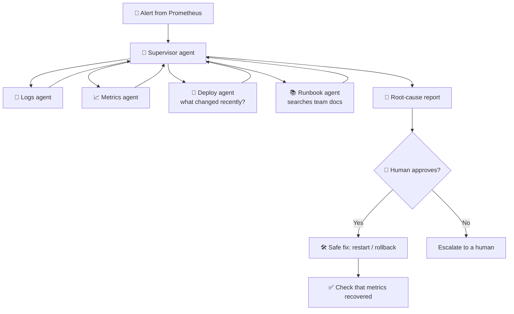

# 🚨 Incident Copilot

**An AI on-call engineer that investigates production incidents, finds the root cause, and fixes things only after a human approves.**

> 🚧 **Being built in public, one day at a time** (Nov 18 – Dec 31, 2026).
> 📖 Follow along: [DAILY_LOG.md](DAILY_LOG.md) · 🎯 Interview prep: [INTERVIEW_QUESTIONS.md](INTERVIEW_QUESTIONS.md)

---

## 🌙 The 3 AM problem

It's 3 AM and your phone buzzes:

```
🔴 ALERT: order-service error rate is above 5%
```

You wake up, open your laptop, and start digging. You read the logs, check the dashboards, ask what was deployed today, and search the runbooks. Forty minutes later you find it: **Redis is timing out and the connection pool is exhausted.**

**Incident Copilot does that digging for you.** By the time you've opened your laptop, it has a report waiting:

```
🔍 Root cause: Redis became unresponsive at 10:42.
   order-service ran out of Redis connections (8/8 used, 31 waiting),
   so every cache read/write failed → HTTP 500s.

📎 Evidence:
   10:42:09  RedisCommandTimeoutException: Command timed out after 2 second(s)
   10:43:10  Redis connection pool exhausted
   ...

🛠️ Suggested fix: restart Redis           [ ✅ Approve ]  [ ❌ Reject ]
```

---

## 🧠 How it works (the target design)

A team of specialist AI agents investigates the incident, like a real on-call team:



**The key idea:** an AI agent is **an LLM + tools + a loop**.

- The **LLM thinks**: *"I should check the logs first."*
- **My code acts**: it runs the tool and reads the logs.
- The result goes back to the LLM, which decides what to check next, until it's confident.

**The AI never touches production by itself.** It can only *ask*, and anything risky needs a human to click Approve.

---

## 🧪 We break it on purpose

To test a copilot you need incidents. So this repo also includes a **small microservice system built to be broken**: Spring Boot services with Kafka, Redis, Postgres and Prometheus.

We inject real failures (Redis going down, slow databases, bad deploys, memory leaks) and check whether the copilot finds the correct root cause. Every injected failure has a known answer, so the copilot gets a **score**, not a vibe check.

---

## 🗺️ Roadmap

| Week | What gets built | Status |
|---|---|---|
| 1 | First tool call → a full agent loop, written from scratch (no frameworks) | 🟡 In progress |
| 1 | The demo microservice system + failure injection | ⬜ |
| 2 | More tools (metrics, deploys), memory, first automated evals | ⬜ |
| 3 | Multi-agent supervisor (LangGraph), human approval, runbook search via **MCP** | ⬜ |
| 4 | Agents as separate services talking over **A2A**, Kafka alert intake, LLM-as-judge | ⬜ |
| 5 | Guardrails (prompt-injection defense, action allow-list), tracing, cost tracking | ⬜ |
| 6 | Evals in CI, live deployment, demo video | ⬜ |

**Done so far:**
- [x] `read_logs` tool: reads a service's logs
- [x] The LLM finds the root cause from the logs (and ignores red herrings)
- [x] **First tool call:** the LLM decides which logs to read; my code runs the tool and sends the result back
- [ ] The agent loop: keep investigating until done

---

## 🛠️ Tech stack

| Part | Tools |
|---|---|
| AI copilot | Python, Groq (LLM), later LangGraph, MCP, A2A, FastAPI |
| System under test | Java 21, Spring Boot, Kafka, Redis, Postgres |
| Monitoring | Prometheus, Alertmanager, Grafana |
| Quality and safety | Custom eval harness, LLM-as-judge, guardrails, Langfuse tracing |
| Ship it | Docker Compose, GitHub Actions, a cloud VM |

---

## ▶️ Run it (current version)

```bash
git clone https://github.com/Ritik2004/incident-copilot.git
cd incident-copilot
python3 -m venv venv && source venv/bin/activate
pip install groq python-dotenv
echo "GROQ_API_KEY=your_key_here" > .env     # free key at console.groq.com
python -m app.agent_v0
```

It reads a sample incident from [data/logs/order-service.log](data/logs/order-service.log) and prints the root cause.

---

## 💡 Lessons so far

- **The LLM never runs your code.** It only *asks* ("please run `read_logs` for order-service"). Your code decides whether and how to run it. That's also why tool calling is a safety boundary.
- **A tool's description is the LLM's only documentation.** My description said `order_service`, so the LLM asked for `order_service` instead of `order-service`. The file wasn't found and the agent gave up. One better sentence fixed it.
- **Don't use an agent if a fixed workflow will do.** Agents are slower, cost more and are harder to test. They're worth it here because *what to check next depends on what you just found*.

More in the [daily log](DAILY_LOG.md).
